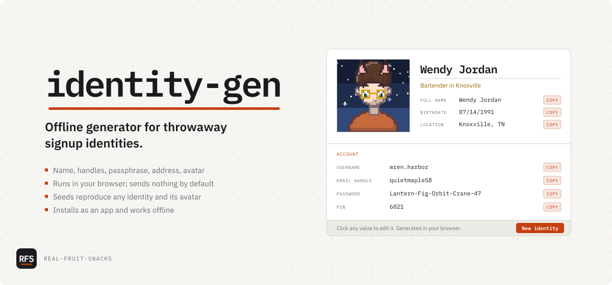

# identity-gen

Offline generator for throwaway signup identities

<picture>
  <source media="(prefers-color-scheme: dark)" srcset="docs/assets/cover-dark.svg">
  
</picture>

Open **[real-fruit-snacks.github.io/identity-gen](https://real-fruit-snacks.github.io/identity-gen/)**. To keep it, use your browser's Install or Add to Home Screen; it then works offline. Or download `index.html` and open it from disk.

Sites keep asking for more about you than they need. One click here makes a complete stand-in: name, username, email handle, passphrase, birthdate, address, job and an avatar, so no two of your accounts share details. It is one HTML file with no server and no build step, and it assumes you keep the result in a password manager.

## What's in it

| Part | Does |
|---|---|
| Identity | Name, gender, birthdate, location, username, display name, email handle, password, PIN, phone, address, occupation, company and a short bio |
| Reroll | Any single field, a whole section, or the entire identity (`N`); `U` steps back through the last ten |
| Editing | Click any value to change it. Add custom fields, and security questions whose answers are generated for you |
| Passwords | Passphrases by default (word count, separator, capitals, trailing number), or random characters with length and character-class controls |
| Avatars | Initials, Pixel (48×48 people with fourteen character kits), Duck, House, six abstract styles, three DiceBear styles, or a photo. Save as a 512px PNG or copy |
| Seeds | Every identity shows a seed that reproduces it and its avatar exactly |
| Export | Plain text, Markdown or JSON to the clipboard, or `.txt` / `.md` files, with the site, notes and seed included |
| Memory | Names and handles already generated on this device are never handed out again; a Recent panel restores any of the last ten |

The email field is a handle only, the part before the `@`, so it pairs with your own alias service or domain.

## Tested on

- Chromium (Playwright) on Ubuntu, every push: 100 renders each of the Pixel, Duck and House styles, seeds, undo, export, reload, theme and version checks (`tests/test_page.py`)
- *Not* tested: Firefox, Safari, mobile browsers. It uses nothing unusual, but I haven't checked.

## Known issues

- The page sends nothing by default. Two opt-in features do make requests: the Illustrated avatar styles load DiceBear from jsDelivr (Initials is shown if that fails), and Photo mode fetches a face from thispersondoesnotexist.com or a URL you set.
- Everything is kept in this browser's local storage. Another browser, another device or a cleared profile starts empty; export anything you need to keep.
- Don't use generated details where you must give accurate information: financial, government, medical or employment services.

## Configuration

All settings are on the page: username and handle rules, password rules, how often Pixel avatars wear a character kit, the photo source, and the theme (Auto, Dayshift or Nightshift). They are saved in the browser. "Reset everything" under Stored on this device clears them along with the current identity, undo history and used-name memory.

To change the page: it is a single file with no build step. Run the checks with `pip install playwright`, `playwright install chromium`, `python tests/test_page.py`. When shipping, set the same version in `index.html` (`const VERSION`), `sw.js` and the top of `CHANGELOG.md`; the test checks they agree, and installed copies then offer a Reload.

## License

MIT. The bundled IBM Plex fonts are under the SIL Open Font License (`fonts/OFL.txt`). DiceBear's Lorelei, Notionists and Open Peeps styles are CC0.
