# identity-gen

Offline generator for throwaway signup identities

<picture>
  <source media="(prefers-color-scheme: dark)" srcset="docs/assets/deck-dark.svg">
  
</picture>

Open **[real-fruit-snacks.github.io/identity-gen](https://real-fruit-snacks.github.io/identity-gen/)** and press **New identity** (<kbd>N</kbd>). To keep it, use your browser's Install or Add to Home Screen; it then works offline. Or download [`index.html`](index.html) and open it from disk.

Sites keep asking for more about you than they need. One key press makes a complete stand-in: name, birthdate, username, email handle, passphrase, PIN, phone, address, job, a short bio and an avatar, so no two of your accounts share details. It is one HTML file with no server and no build step, it sends nothing by default, and it assumes you keep the result in a password manager.

## One seed, the whole identity

Every card above is what the page gave back for the seed printed on it. Paste the front one, `881ed162ae2eb154-c7a2ea20b2f14c94`, into **Paste a seed to restore**, set the avatar style to Pixel, and **Download .txt** saves this:

```text
Wren Elliott

Basics
  Full name: Wren Elliott
  Birthdate: 03/26/1991 (age 35)
  Gender: Non-binary
  Location: Seattle, WA

Account
  Username: olivewillowrook
  Display name: Wren E.
  Email handle: warm.holly
  Password: View-Shelf-Dial-File-79
  PIN: 1698
  Phone: (555) 017-5184

Profile
  Street: 4349 Clover Ct
  City: Seattle
  State: WA
  ZIP: 98147
  Country: United States
  Occupation: Technical writer
  Company: Wren Print
  Language: Arabic
  Favorite color: Sky blue
  Hobby: thrifting
  Bio: Seattle local. Technical writer. Thrifting on the side.

Seed: 881ed162ae2eb154-c7a2ea20b2f14c94
```

The first half of a seed makes the fields and the second half the avatar, so the same seed with the same settings gives the same person on any copy of the page. The one thing that moves is the birth year, which counts back from today: in 2027 Wren is born in 1992. [`docs/art/make-deck.py`](docs/art/make-deck.py) draws the deck by loading six seeds into `index.html` this way, and CI checks the result still matches.

## What's in it

| Part | Does |
|---|---|
| Identity | Name, gender, birthdate, location, username, display name, email handle, password, PIN, phone, address, occupation, company and a short bio |
| Reroll | Any single field, a whole section, or the entire identity (<kbd>N</kbd>). <kbd>P</kbd> draws a new avatar; <kbd>U</kbd> steps back through the last ten |
| Editing | Click any value to change it. Add custom fields, and security questions whose answers are generated for you |
| Passwords | Passphrases by default (word count, separator, capitals, trailing number), or random characters with length and character-class controls |
| Avatars | Initials, Pixel (48×48 people with fourteen character kits), Duck, House, six abstract styles, three DiceBear styles, or a photo. Save as a 512px PNG or copy |
| Seeds | Every identity shows a seed that brings it and its avatar back, given the same username, password and avatar settings |
| Export | Plain text, Markdown or JSON to the clipboard, or `.txt` / `.md` files, with the site, notes and seed included |
| Memory | A Recent panel restores any of the last ten. Rerolling a name, username or email handle skips ones an earlier reroll on this device gave out |

The email field is a handle only, the part before the `@`, so it pairs with your own alias service or domain.

## Tested on

- Chromium (Playwright) on Ubuntu, on every push to `main` and every pull request: 100 renders each of the Pixel, Duck and House styles, seeds, undo, export, reload, theme and version checks (`tests/test_page.py`), and the six seeds in the deck above, regenerated and compared
- *Not* tested: Firefox, Safari, mobile browsers. It uses nothing unusual, but I haven't checked.

## Known issues

- The page sends nothing by default. Two opt-in features do make requests: the Illustrated avatar styles load DiceBear from jsDelivr (Initials is shown if that fails), and Photo mode fetches a face from thispersondoesnotexist.com or a URL you set.
- Everything is kept in this browser's local storage. Another browser, another device or a cleared profile starts empty; export anything you need to keep.
- Addresses are a random number and street in a real city with a ZIP from that city's range, so one can match a real address by chance. Phone numbers are `(555) 01X-XXXX`; a US exchange can't start with 0, so they don't ring anyone.
- Don't use generated details where you must give accurate information: financial, government, medical or employment services.

## Settings

All settings are on the page: username and handle rules, password rules, how often Pixel avatars wear a character kit, the photo source, and the theme (Auto, Dayshift or Nightshift). They are saved in the browser. "Reset everything" under Stored on this device clears them along with the current identity, undo history and used-name memory.

## Changing the page

It is a single file with no build step. Run the checks with `pip install playwright`, `playwright install chromium`, `python tests/test_page.py`. When shipping, set the same version in `index.html` (`const VERSION`), `sw.js` and the top of `CHANGELOG.md`; the test checks they agree, and installed copies then offer a Reload.

If a change alters what a seed produces, the deck above changes with it. Redraw it and commit the two SVGs:

```sh
pip install -r docs/art/requirements.txt
python -m playwright install chromium
python docs/art/make-deck.py
```

## License

[MIT](LICENSE). The bundled IBM Plex fonts are under the SIL Open Font License (`fonts/OFL.txt`), as are the Atkinson Hyperlegible fonts in `docs/art/fonts`, which only the README art uses. DiceBear's Lorelei, Notionists and Open Peeps styles are CC0. [Changelog](CHANGELOG.md) · [Security](SECURITY.md) · [Contributing](CONTRIBUTING.md)
