# identity-gen

Offline generator for throwaway signup identities

<picture>
  <source media="(prefers-color-scheme: dark)" srcset="docs/assets/deck-dark.svg">
  
</picture>

```sh
curl -fsSLO https://github.com/Real-Fruit-Snacks/identity-gen/releases/latest/download/index.html
```

- **Zero-setup web app:** Open [real-fruit-snacks.github.io/identity-gen](https://real-fruit-snacks.github.io/identity-gen/) (or install as a PWA / open the standalone `index.html` offline) and press **New identity** (<kbd>N</kbd>).
- **Complete stand-in:** Generates name, birthdate, username, email handle (before `@`), passphrase/PIN, phone, address, job, bio, security questions, and a 512px PNG avatar.
- **Deterministic seeds:** Every identity carries a seed that reproduces both its fields and avatar across devices with matching settings.
- **Local-first privacy:** Single HTML file with bundled fonts and zero network requests by default; exports plain text, Markdown, or JSON for your password manager.

## Documentation

- [Open Live App](https://real-fruit-snacks.github.io/identity-gen/)
- [Usage, Seeds, Settings & Development](docs/USAGE.md)
- [Changelog](CHANGELOG.md) · [Contributing](CONTRIBUTING.md) · [Security](SECURITY.md)

## License

[MIT](LICENSE). Bundled fonts are SIL OFL 1.1 (`fonts/OFL.txt`); DiceBear Lorelei, Notionists, and Open Peeps styles are CC0.
